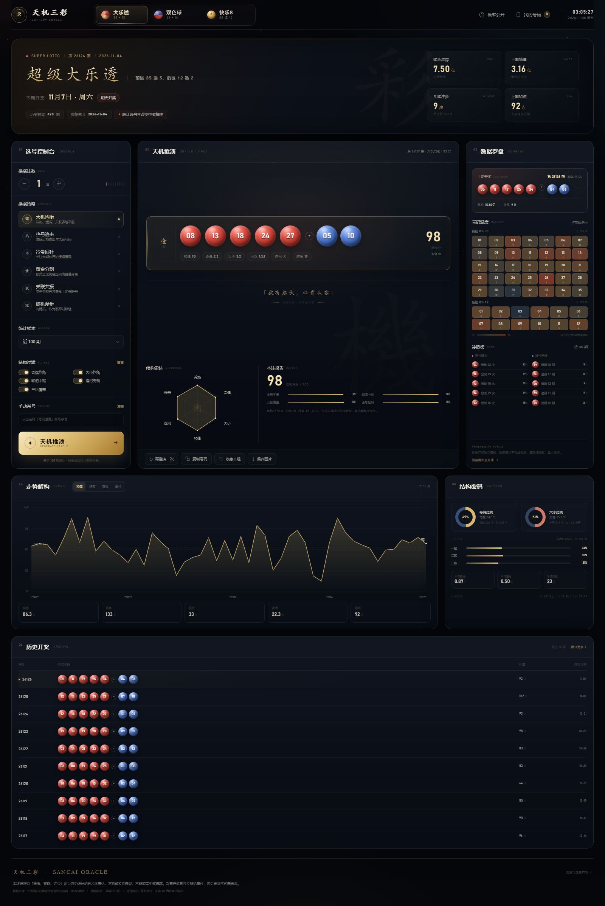
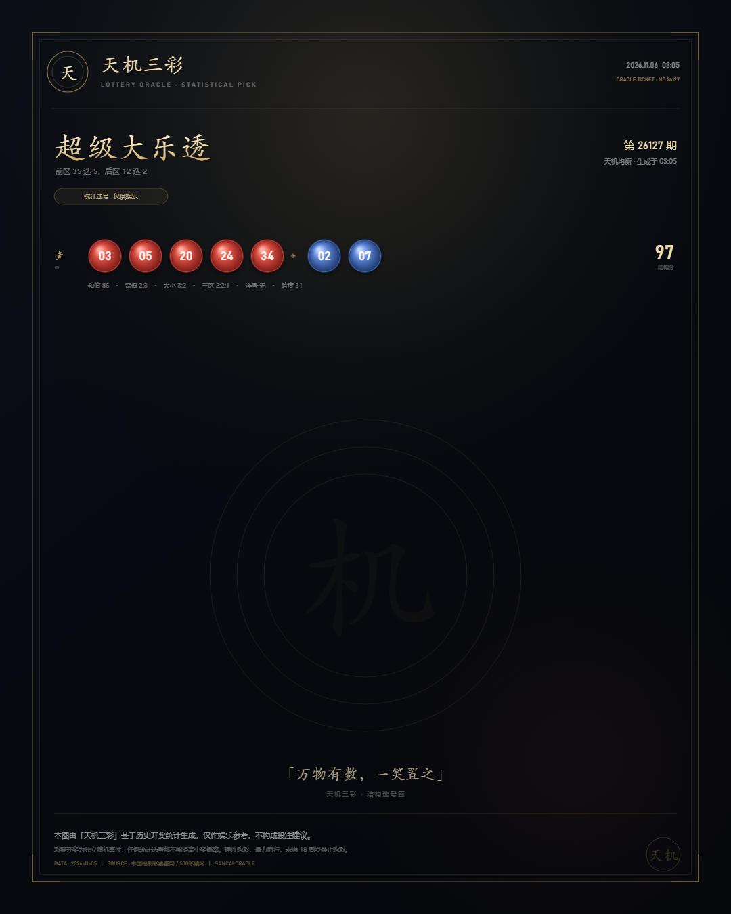
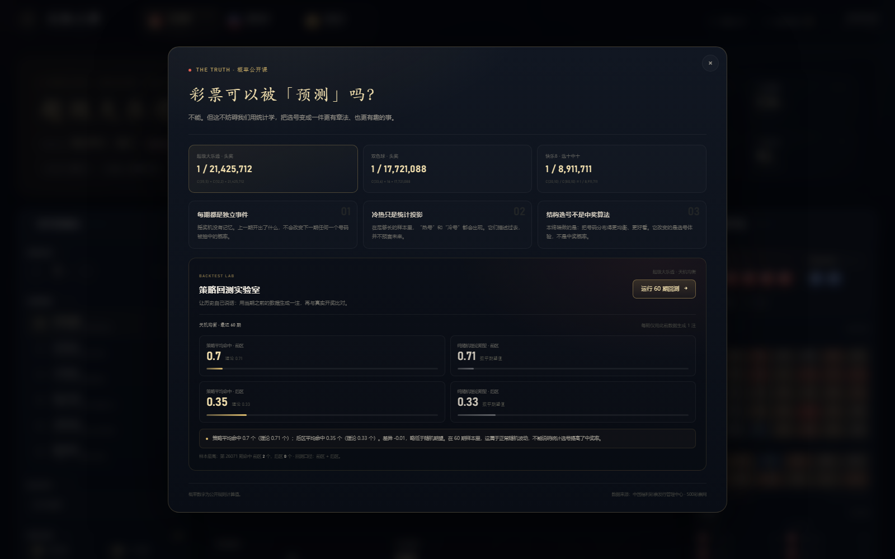

# 天机三彩 · 三彩种统计选号终端

一台可以离线运行的中文选号终端，覆盖 **超级大乐透**、**福彩双色球**、**快乐8** 三种玩法。

它不做“必中”的承诺，而是把真实历史开奖、频率/遗漏/关联统计、结构过滤和号码美学，做成一个有质感的选号工作台。



---

## 立即打开

**推荐：双击 [天机三彩.html](天机三彩.html)** — 单文件离线版，包含全部数据、样式和逻辑，不需要安装任何东西。

也可以打开多文件版 [index.html](index.html)，适合继续修改代码。

> 浏览器建议：Chrome / Edge 120+。桌面最佳宽度 1440–1600px；手机端已适配。

---

## 在线版 / 手机使用

仓库中已准备好 **在线版 + PWA + 每日自动更新** 所需的全部文件：

- `site/`：在线版页面、manifest、Service Worker、App 图标；
- `.github/workflows/update-pages.yml`：每天开奖后自动抓取数据、重建并发布到 GitHub Pages；
- `ONLINE.md`：从零上线、添加主屏幕、自定义域名与故障排查的完整说明。

上线后手机打开网址即可用，并支持「添加到主屏幕」；页面带离线缓存，断网也能打开最近一次内容。

**部署方式：** 见 [ONLINE.md](ONLINE.md)。把本目录推到 GitHub 仓库，开启 Pages 的 GitHub Actions 来源，运行一次工作流即可。

**本地局域网预览：**

```bash
node tools/serve_online.mjs
```

> 在线版的公开部署需要一个 GitHub 仓库 / 静态托管位置；部署步骤见 [ONLINE.md](ONLINE.md)。

---

## 三种玩法

| 彩种 | 规则 | 内置历史数据 |
| --- | --- | --- |
| 超级大乐透 | 前区 35 选 5，后区 12 选 2 | 428 期 · 2024-01-01 → 2026-11-04 |
| 福彩双色球 | 红球 33 选 6，蓝球 16 选 1 | 300 期 · 2024-11-12 → 2026-11-05 |
| 快乐8 | 80 选 1–10，每期开出 20 个号码 | 400 期 · 2025-09-14 → 2026-11-05 |

快乐8支持 **选十 / 选九 / … / 选一** 共 10 种玩法。

---

## 功能

- **六种统计策略**：天机均衡、热号追击、冷号回补、黄金分割、关联共振、随机漫步（对照组）。
- **结构过滤**：奇偶、大小、和值、连号、三区覆盖；可一键重置。
- **手动杀号**：点击右侧「号码温度」格子即可排除号码，下一次推演自动避开。
- **统计样本**：近 30 / 50 / 100 / 200 / 全部期数。
- **推演注数**：一次生成 1–10 注；每注有独立的结构评分。
- **数据罗盘**：最新开奖、冷热榜、频率/遗漏热力图、近期和值/跨度/奇数/重号走势。
- **历史开奖**：可展开最近 10 / 20 / 30 / 50 / 100 期。
- **号码管理**：复制全部号码、收藏本组、单注复制/删除，收藏保存在本机 localStorage。
- **分享图片**：一键导出 1080×1350 的暗金号码海报，含结构标签与免责声明。
- **概率公开课**：真实头奖概率、独立随机事件说明，以及“策略回测实验室”——用最近 60 期逐期回测，把策略平均命中与纯随机数学期望放在一起比较。
- **响应式布局**：1600 / 1024 / 768 / 390 像素宽度均通过无横向溢出检查。
- **完全离线**：无外部字体、无 CDN、无追踪脚本、无网络请求。



---

## 关于「预测」

彩票每期开奖是独立随机事件。历史频率、遗漏、冷热、关联关系都只是对过去的统计描述，**不能改变下一期的中奖概率**。

这个终端做的是：

1. 用真实历史数据计算统计特征；
2. 用不同策略生成结构更均衡、更有“章法”的号码组合；
3. 用回测和概率公开课诚实地展示：策略命中率长期回归随机期望。

它的价值在于 **有趣的选号体验和统计可视化**，而不是中奖承诺。

---

## 数据来源

- 超级大乐透：[500彩票网历史开奖](https://datachart.500.com/dlt/history/)
- 双色球、快乐8：[中国福利彩票发行管理中心公开接口](https://www.cwl.gov.cn/ygkj/wqkjgg/)

数据在构建时抓取并内嵌，截止 **2026-11-05**。页面不会自动联网更新。

### 更新数据

需要 Node.js 18+ 与网络：

```bash
node tools/fetch_data.mjs      # 抓取、校验并写入 data.json / js/data.js
node tools/build_single.mjs    # 重新生成单文件版「天机三彩.html」
```

---

## 项目结构

```text
lottery-oracle/
├─ 天机三彩.html          # 单文件离线成品（推荐直接打开）
├─ index.html             # 多文件版入口
├─ ONLINE.md              # GitHub Pages 在线版部署指南
├─ css/style.css          # 视觉系统
├─ js/
│  ├─ data.js             # 内嵌历史开奖数据
│  ├─ engine.js           # 统计、策略、结构评分、回测引擎
│  └─ app.js              # 界面交互与渲染
├─ site/                  # 在线版 PWA（manifest / sw / icons）
├─ .github/workflows/     # 每日自动抓取 + 部署 Pages
├─ data.json              # 原始数据（供测试/工具使用）
├─ screenshots/           # 成品截图
└─ tools/
   ├─ fetch_data.mjs      # 数据抓取与校验
   ├─ build_single.mjs    # 多文件 → 单文件打包
   ├─ build_online.mjs    # 生成带 PWA 的 site/index.html
   ├─ serve_online.mjs    # 本地 / 局域网预览在线版
   ├─ make_icons.py       # 生成 PWA 图标（需要 Pillow）
   ├─ check_online.mjs    # PWA / Service Worker / 断网缓存检查
   ├─ engine.test.mjs     # 引擎断言测试
   └─ final-qa.mjs        # Chrome CDP 浏览器端验收与截图
```

## 测试

```bash
node tools/engine.test.mjs
node tools/final-qa.mjs

# 在线版（先运行 serve_online.mjs）
node tools/check_online.mjs
```

- 引擎测试：1630+ 项断言，覆盖三种彩种、六种策略、选号范围/去重/排序、杀号、过滤、可复现性、回测。
- 浏览器验收：26 项检查，覆盖初始渲染、三彩种切换、快乐8玩法、多注、样本窗口、杀号、过滤、复制、收藏/删除、概率公开课、回测、分享图、1024/768/390 布局与控制台错误。
- 在线版 PWA 检查：manifest、图标、Service Worker 注册、断网刷新后仍可打开。



---

## 免责声明

本项目仅供娱乐、统计学习与前端交互展示，不构成任何投注建议。彩票是一种娱乐方式，不是投资工具；请理性购彩、量力而行。未满 18 周岁禁止购彩。
